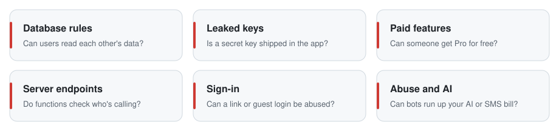
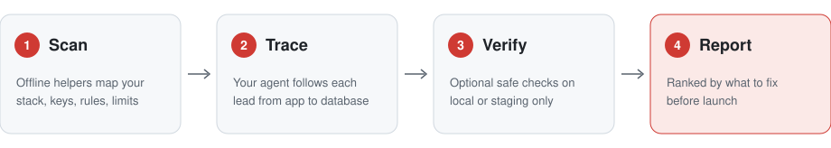

# BreakALeg

**Give your app a security rehearsal before launch.**

[](https://github.com/notsocj/break-a-leg/actions/workflows/test.yml)
[](LICENSE)


BreakALeg is an open-source skill for coding agents. It reviews your mobile app and its backend the way an attacker would, then tells you in plain language what to fix before launch.

## The problem

You can ship an app in a weekend now. The bugs that sink launches are still the same handful:

- **Users can read each other's data** because a Supabase table has no RLS, or a Firebase rule only checks "signed in".
- **A secret key ships inside the app**, and anyone can pull it out.
- **Premium is decided on the phone**, so anyone can unlock Pro for free.
- **A server function trusts whoever calls it.**
- **Someone runs up your bill** through an AI chat, SMS codes, or emails with no limit.

A generic "review my code" prompt misses these or buries them in noise. BreakALeg sends your agent straight to where they hide, gives it offline tools to find leads, and makes it report only what it can back up.

<picture>
  <source media="(prefers-color-scheme: dark)" srcset="docs/assets/what-it-checks-dark.svg">
  
</picture>

## Quick start

**1. Install** (needs Git and Python 3):

```sh
git clone https://github.com/notsocj/break-a-leg.git
cd break-a-leg
python3 scripts/install.py --agent claude   # Claude Code
python3 scripts/install.py                  # Codex
```

**2. Ask.** Open your app's repo in Claude Code or Codex, start a new session, and ask:

```text
Is my app safe to launch?
```

You can also run `/break-a-leg` in Claude Code or mention `$break-a-leg` in Codex.

**3. Read the report.** It opens with what to fix before launch.

You don't need staging, test accounts, a simulator, or an extra API key. Source code is enough for a first review. The full walkthrough is in [Getting started](docs/getting-started.md).

## How it works

<picture>
  <source media="(prefers-color-scheme: dark)" srcset="docs/assets/how-it-works-dark.svg">
  
</picture>

1. **Scan.** Offline helper commands map your stack and list leads: leaked keys, risky Supabase rules, endpoints without rate limits. Nothing leaves your machine.
2. **Trace.** Your agent follows each lead from the app to the server to the database before it calls something a finding. A visible public key alone is not a bug.
3. **Verify (optional).** With a local or staging backend and two test accounts, the helper checks whether one user can read another's data. Read-only, bounded, never production.
4. **Report.** Plain-language launch priority first, then evidence, fixes, and what was not checked.

## What a report looks like

A shortened example:

```text
## Launch priority

Fix before launch
- journal_entries has no RLS: any signed-in user can read every journal (high, source-supported)
- /api/chef has no server-side quota: one account can spend the whole AI budget (high, source-supported)

Fix soon
- The import limiter uses an in-memory Map, which resets on every serverless instance (medium)

Good to know
- Chef's system prompt can be revealed; it contains no secrets

Not checked: live backend, native device. See the coverage table.
```

Each finding then lists its impact, file and line, steps to reproduce, the fix, and how to retest. Its label says how sure the review is: `runtime-reproduced`, `source-supported`, or `needs-verification`. Full examples: [vulnerable demo report](examples/demo-reports/vulnerable.md), [secure counterpart](examples/demo-reports/secure.md), [source-only review](examples/source-review.md).

## What it covers

| Area | Support |
| --- | --- |
| Mobile | Flutter, React Native/Expo, Swift/iOS, Kotlin/Android, plus generic guidance for other stacks |
| Backend | Supabase, Firebase, custom REST/GraphQL APIs |
| Checks | Ownership and roles, leaked credentials, server validation, storage, paid features, sign-in/OAuth/deep links, AI features, rate limits and abuse, local-first data (app lock, backups, deletion) |

The skill guides the agent's reasoning; it is not an exhaustive automated scanner. The [coverage contract](skills/break-a-leg/references/coverage.md) lists exactly what is checked and how.

## Helper commands

A zero-dependency TypeScript helper ships inside the skill. It needs Node 22.18+ (24 LTS recommended) and no `npm install`. Everything except `run` is offline.

| Command | What it does |
| --- | --- |
| `discover` | Detects your stack and suggests which checks to read |
| `secrets` | Finds likely leaked keys; reports type and location, never the value |
| `rls-audit` | Replays Supabase migrations and `config.toml`; lists risky rules |
| `limits` | Lists AI, SMS, email, and password endpoints with no rate limit or quota |
| `validate` | Checks a test plan before running it |
| `run` | Bounded read-only check: can another user or an anonymous caller read one user's data? |

```sh
node skills/break-a-leg/scripts/break-a-leg.mjs discover /path/to/app
node skills/break-a-leg/scripts/break-a-leg.mjs secrets /path/to/app
node skills/break-a-leg/scripts/break-a-leg.mjs rls-audit /path/to/app
node skills/break-a-leg/scripts/break-a-leg.mjs limits /path/to/app
```

`secrets`, `rls-audit`, and `limits` exit 1 when they find something to review. A lead is a place to look, not a confirmed bug. `run` exits **0** when the configured checks found nothing, **1** for findings with complete coverage, and **2** for errors or incomplete coverage. No exit code certifies an app as secure. The `run` limits (no redirects, no retries, request and size caps, stop on 429/5xx) apply to its own requests; it is not a sandbox. Details: [runner guide](skills/break-a-leg/references/runner.md) and [runner walkthrough](docs/runner-walkthrough.md).

## Try the demo

From the repository root:

```sh
npm test
npm run demo
```

The demo starts two temporary loopback-only fake APIs, one vulnerable and one secure, runs the same private-note check against both, and writes reports under `.break-a-leg/demo/`. The vulnerable one yields two findings (another user and an anonymous caller can read the note); the secure one yields none. It never connects to a real app or database.

## Modes

| Mode | What it does |
| --- | --- |
| Review | Reads source, config, and policies, and runs isolated project tests with synthetic data. No traffic to your backend |
| Local | Bounded checks against an isolated backend or emulator on your machine |
| Staging | Bounded checks against an explicitly scoped HTTPS staging origin |

If only production exists, BreakALeg stays in review mode. A staging database is not enough if auth, storage, payments, email, or functions still point to production. It never sets up environments silently.

## Install options

The installer copies the whole self-contained `skills/break-a-leg` folder (guides, helper, schemas) and refuses to overwrite an existing install.

| Task | Command |
| --- | --- |
| Install for Claude Code (`~/.claude/skills`) | `python3 scripts/install.py --agent claude` |
| Install for Codex (`$CODEX_HOME/skills` or `~/.codex/skills`) | `python3 scripts/install.py` |
| Install somewhere else | `python3 scripts/install.py --skills-dir /path/to/skills` |
| Update after `git pull` | `python3 scripts/install.py --update` |

Updates back up the previous copy, including your local edits, under `skill-backups/` next to the skills directory, and print the exact path. For other agents that use the same skill-folder format, copy the folder into their skill location; only Codex and Claude Code are documented targets.

Requirements: Python 3.8+ for the installer (or copy the folder by hand), Node 22.18+ for the helper. Active checks also need an explicitly scoped local or staging target, two ordinary test accounts, a trusted identity endpoint, and a synthetic private record. Pass secrets through environment variables, never plan files.

BreakALeg has no telemetry, hosted account, or model API key of its own. Your coding agent's model connection and data handling still apply.

## What BreakALeg does not promise

No security certification, App Store approval, exhaustive vulnerability detection, automatic fixes, testing against production, password guessing, load testing or rate-limit stress testing, or turnkey simulator and binary testing. When tools, credentials, fixtures, or backend access are missing, it reports the check as not done instead of claiming a result.

The included tests use a synthetic HTTP service and fake projects. They do not prove live Firebase/Supabase integration or native app behavior, and every report must say what evidence it actually has.

## Documentation

| Goal | Guide |
| --- | --- |
| Install and run a first review, with or without staging | [Getting started](docs/getting-started.md) |
| Try the demo or configure a bounded API check | [Runner walkthrough](docs/runner-walkthrough.md) |
| Understand findings, incomplete coverage, or an error | [Reports and troubleshooting](docs/reports-and-troubleshooting.md) |
| See supported checks and their limits | [Coverage contract](skills/break-a-leg/references/coverage.md) |
| Understand the implementation or add a capability | [Architecture](docs/architecture.md) · [Contributing](CONTRIBUTING.md) |
| Validate, package, and publish a version | [Maintainer guide](docs/maintaining.md) |
| See validation results and version history | [Verification](VERIFICATION.md) · [Changelog](CHANGELOG.md) |

## For contributors

```text
skills/break-a-leg/  Installable skill, references, and bundled helper
runner/             Canonical TypeScript helper source
schemas/            Canonical plan/report JSON schemas
scripts/            Bundling, installer, packaging, doc checks
examples/           Plans and generated synthetic example reports
docs/               User walkthroughs, troubleshooting, maintainer guides, README images
tests/              Behavioral tests and vulnerable/secure fixtures
evals/              Manual skill reasoning cases and separate grading rubrics
```

Edit `runner/` and `schemas/`, then run `npm run bundle`; the copies inside the skill are generated so installation needs no build. CI runs type checking, bundle parity, doc links, and the JavaScript and Python tests on Node 22 and 24. See [CONTRIBUTING.md](CONTRIBUTING.md).

Six manual evaluations check the agent's reasoning on fictional apps, each run with and without the skill: [local-first](evals/local-first/request.md), [Supabase backend](evals/supabase-rls/request.md), [false positives](evals/false-positives/request.md), [AI abuse](evals/ai-abuse/request.md), [multi-tenant Supabase](evals/supabase-orgs/request.md), and [Firebase marketplace](evals/firebase-marketplace/request.md). Give the rubric to the grader only after the agent answers. Results are in [VERIFICATION.md](VERIFICATION.md).

## License and security

[MIT](LICENSE). [Report a vulnerability privately](https://github.com/notsocj/break-a-leg/security/advisories/new) or see [SECURITY.md](SECURITY.md). Use ordinary issues for reproducible bugs and feature requests, without credentials or private assessment data.
